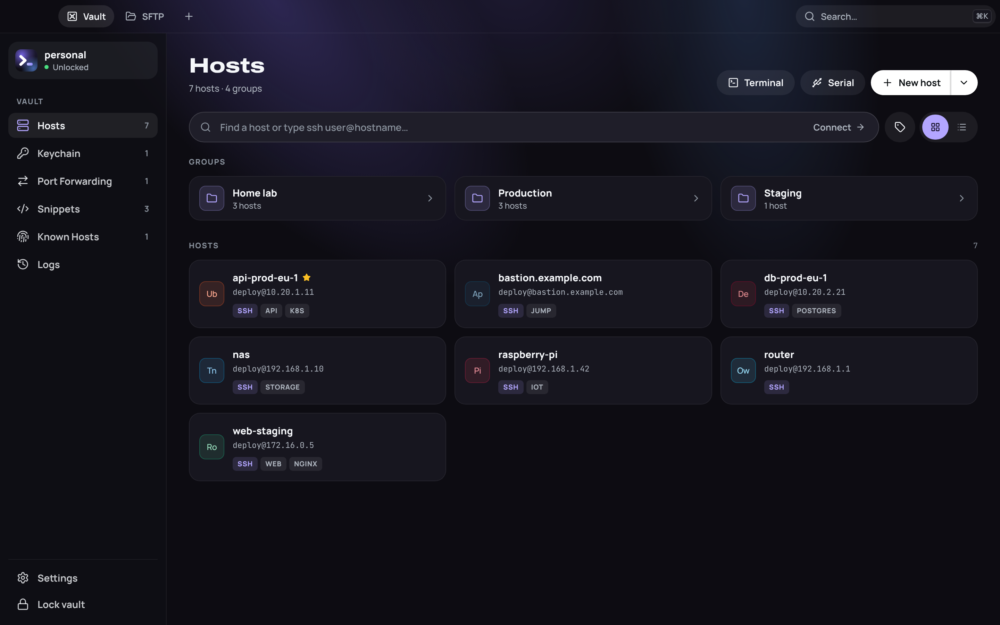
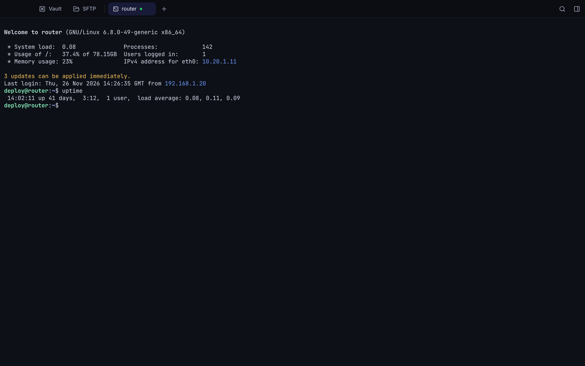
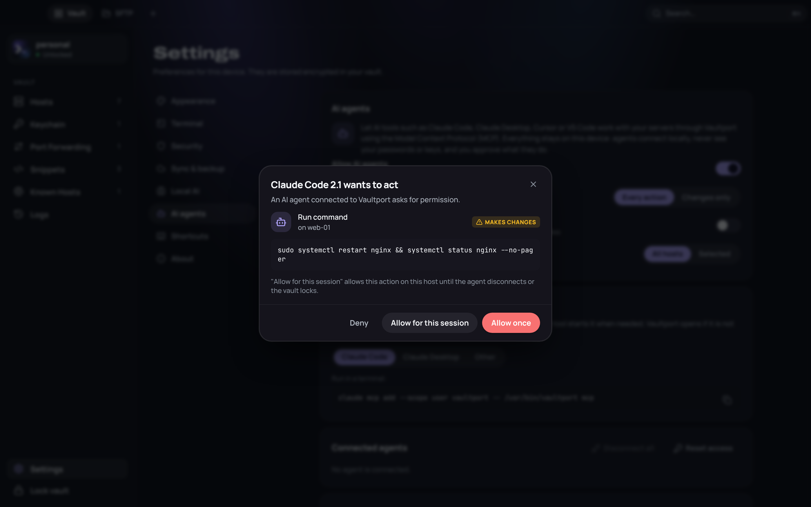
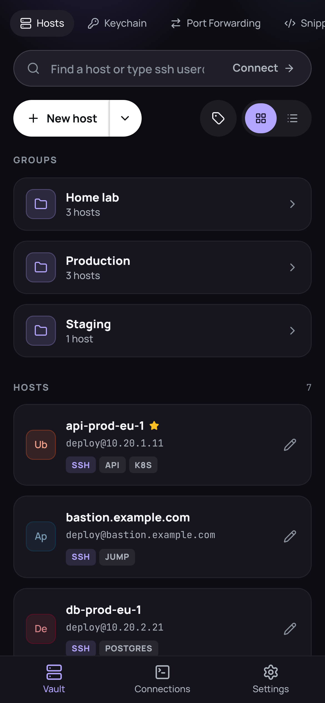

<!-- SPDX-License-Identifier: GPL-3.0-or-later -->

# Vaultport

**A secure, serverless SSH, SFTP, Mosh, Telnet and serial client for Windows, macOS, Linux,
Android and iOS.** Your hosts, keys and snippets live in an end-to-end encrypted vault on your
devices and sync only through storage you control. There are no accounts, no telemetry and no
servers run by this project.

[](https://github.com/DavidNiessen/vaultport/actions/workflows/ci.yml)
[](https://github.com/DavidNiessen/vaultport/actions/workflows/codeql.yml)
[](https://securityscorecards.dev/viewer/?uri=github.com/DavidNiessen/vaultport)
[](LICENSE)

[Website & docs](https://vaultport.niessen.dev/) ·
[Download](https://vaultport.niessen.dev/download) ·
[llms.txt](https://vaultport.niessen.dev/llms.txt) ·
[Security](SECURITY.md) · [Contributing](CONTRIBUTING.md)



<table>
  <tr>
    <td></td>
    <td></td>
    <td width="22%"></td>
  </tr>
</table>

## Features

| Area              | What you get                                                                                                                                                                                                                                                      |
| ----------------- | ----------------------------------------------------------------------------------------------------------------------------------------------------------------------------------------------------------------------------------------------------------------- |
| Connections       | SSH with post-quantum key exchange (`mlkem768x25519-sha256`), jump-host chains, HTTP/SOCKS proxies, agent forwarding with confirmation, env vars, startup snippets, keep-alive and auto-reconnect. Native Mosh (no external binary), Telnet, serial, local shell. |
| Terminal          | xterm.js with WebGL, truecolor, OSC 7/8/52/133, search, themes and fonts, split workspaces with broadcast input, session pills and an accessory bar on mobile.                                                                                                    |
| SFTP              | Dual-pane local↔remote and remote↔remote browser, transfer queue with resume, drag and drop, permissions, edit locally and re-upload.                                                                                                                             |
| Keys & identities | Ed25519/ECDSA/RSA generation and import, OpenSSH certificates, FIDO2 `sk-` keys, non-exportable keys in the Secure Enclave, Windows Hello/TPM and Android Keystore, identities shared across hosts, "install on host".                                            |
| Organisation      | Groups with per-setting inheritance, tags, snippets with `{{variables}}`, port-forwarding rules, known hosts with strict host-key checking, encrypted session logs with replay.                                                                                   |
| Import            | `~/.ssh/config`, `known_hosts`, CSV, PuTTY, MobaXterm, SecureCRT; AWS, DigitalOcean and Azure inventories (credentials stay on the device).                                                                                                                       |
| Sync              | End-to-end encrypted, conflict-free sync through a folder (iCloud Drive, Dropbox, Syncthing…), WebDAV or S3-compatible storage, encrypted `.vaultport` backups, QR pairing.                                                                                        |
| Local AI          | Optional command generation with a small model that downloads automatically and runs fully on the device. Suggestions are inserted, never executed.                                                                                                               |
| AI agents         | Built-in [MCP](https://modelcontextprotocol.io) server: Claude Code, Claude Desktop, Cursor, VS Code or Codex can list hosts, run commands, read and write files and manage tunnels — locally, without seeing credentials, with your approval in the app.         |
| Design            | Native-feeling custom title bar per OS, dark/light themes, keyboard-first with a command palette, responsive from phone to desktop, English and German.                                                                                                           |

## Security at a glance

- **Secrets never reach the web UI.** Keys and passwords live only in the Rust core and are
  zeroised after use.
- **Vault encryption:** XChaCha20-Poly1305 per record. The vault key is wrapped by an
  Argon2id-derived key and/or a device key in the OS key store.
- **Hardened app shell:** Tauri isolation pattern, strict CSP, least-privilege capabilities.
- **Defaults that refuse weak crypto:** legacy algorithms are opt-in per host.
- **Sync backends only ever see ciphertext.** Hash chains detect rollback and truncation.
- **Supply chain:**
  - every GitHub Action is pinned by SHA; checks with cargo-deny, CodeQL, OpenSSF Scorecard and nightly fuzzing;
  - releases ship SHA-256 checksums signed with Sigstore, an SPDX SBOM and build provenance.

Read the [security documentation](https://vaultport.niessen.dev/security/) and the
[threat model](https://vaultport.niessen.dev/security/). Report vulnerabilities as
described in [SECURITY.md](SECURITY.md).

## Use with AI agents

Turn on **Settings → AI agents**, then register Vaultport as an MCP server. For example, with
Claude Code:

```bash
claude mcp add --scope user vaultport -- /path/to/vaultport mcp
```

The app shows the exact command or JSON for each supported client. Agents connect through a
local socket that only your user can open. Every action that changes something needs your
approval, and so does every read unless you relax that. You can restrict agents to selected
hosts or to read-only tools, and every call is listed in the activity log.

## Building from source

Prerequisites:

- Rust: the version in `rust-toolchain.toml` (rustup installs it).
- Node.js 22 and pnpm 10.
- The [Tauri prerequisites](https://v2.tauri.app/start/prerequisites/) for your platform.

```bash
pnpm install
```

```bash
pnpm dev
```

```bash
pnpm build
```

Run the checks CI runs:

```bash
cargo fmt --all --check && cargo clippy --workspace --all-targets -- -D warnings && cargo test --workspace
```

```bash
pnpm lint && pnpm typecheck && pnpm test && pnpm format:check
```

The protocol integration tests use Docker test servers. See
[docker/test-servers](docker/test-servers/README.md) and [CONTRIBUTING.md](CONTRIBUTING.md).
Mobile builds use `pnpm tauri android build` and `pnpm tauri ios build` from `apps/desktop`.

## Repository layout

```text
apps/desktop/        Tauri app: React UI (src/) and Rust shell (src-tauri/)
crates/              core libraries: vault, ssh-engine, sftp-engine, mosh-proto, telnet-proto,
                     serial-io, hw-keys, sync, importers, cloud-inventory, session-log,
                     term-intel, local-ai, mcp-server, core-model
plugins/mobile/      native Android (Kotlin) and iOS (Swift) services
docs/                website and documentation (VitePress), deployed to GitHub Pages
fuzz/                cargo-fuzz targets for every parser and decoder
docker/test-servers/ OpenSSH and friends for integration tests
```

## Project status

Vaultport is pre-1.0. These parts are not finished yet:

- **Git sync:** the engine supports it, but the app does not offer it yet.
- **Autocomplete:** the deterministic autocomplete engine is not yet connected to the terminal.
- **Not yet tested on real hardware:**
  - FIDO2 keys, Secure Enclave, Windows Hello, Android Keystore and serial devices;
  - Mosh against a real `mosh-server`;
  - the mobile builds.

Issues and pull requests are welcome.

## License

Vaultport is free software under the [GNU General Public License v3.0 or later](LICENSE).
Third-party licenses are listed in [LICENSES](LICENSES) and in each release's SBOM.
